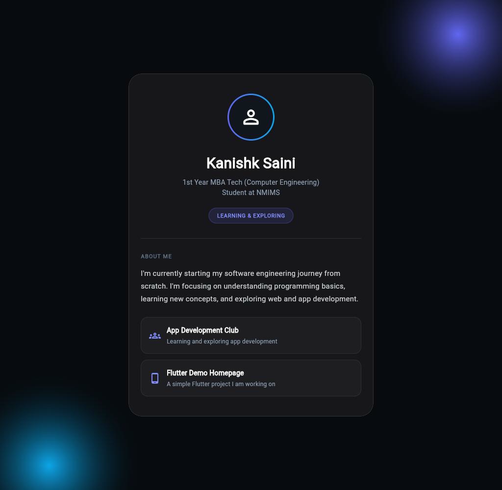
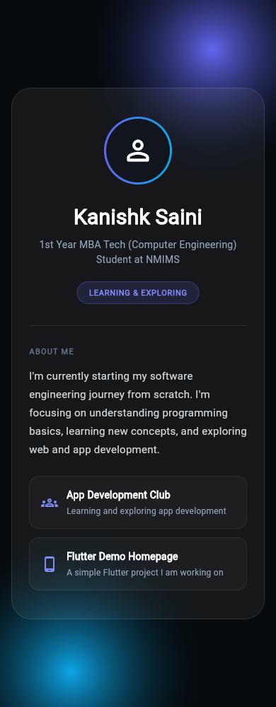

# Flutter Application 01

[Open the live web app](https://kanishksaini-007.github.io/Flutter_Application_01/)

A beginner Flutter profile page by Kanishk Saini, originally made for App Development Club onboarding. This is an improved copy of the original project, not a production app.

## What it does

Shows a student profile, an about section, a learning-status badge and two information cards. The dark glass-style design uses a blurred card and blue/purple background glows. The page scrolls on small screens. The cards and badge are informational, not clickable controls.

There is no sign-in, backend, analytics or saved user data. The profile text is bundled with the app.

## Screenshots

Actual screenshots of this version running as a Flutter web build:





## Run locally

Install Flutter stable with Dart 3.13.2 or newer. This version was checked with Flutter 3.47.7 and Dart 3.13.5.

```sh
flutter pub get
flutter run -d chrome
```

For Android or iOS, select a connected device with `flutter devices`, then run `flutter run`. Native project scaffolding is retained from the original; native builds were not tested in this update.

## Check and build

```sh
dart format --output=none --set-exit-if-changed lib test
flutter analyze
flutter test
flutter build web --no-wasm-dry-run
```

Static analysis has no issues. Five widget tests cover profile content, scrolling at 320px/390px/1024px and large text. Debug and release web builds compile successfully. The app was visually checked at desktop and mobile sizes. The automated Pages workflow runs formatting, analysis and tests before each release deployment.

## Structure

```text
lib/main.dart                           app entry and theme
lib/profile/profile_page.dart           profile layout
lib/profile/widgets/profile_info_card.dart  reusable detail card
lib/dart_basics.dart                     standalone Dart learning exercise
test/widget_test.dart                   profile and layout tests
docs/                                   real screenshots
.github/workflows/pages.yml               checks and release web deployment
android/ ios/ web/ linux/ macos/ windows/ original platform scaffolding
```

Run the separate exercise with `dart run lib/dart_basics.dart`.

## Changes from the original

- Split the single UI file into a page and reusable widget.
- Replace deprecated opacity calls with `withValues(alpha: ...)`.
- Give narrow screens more room while preserving the original design and profile text.
- Replace the unrelated counter test with tests for the actual profile.
- Fix the async return type and formatting in the Dart exercise.
- Replace inaccurate feature claims with setup instructions, real screenshots and test limits.

The original repository and its history are retained in this migrated copy. App-store publishing, native signing, editing the profile at runtime and social-link actions are outside this project's scope.
